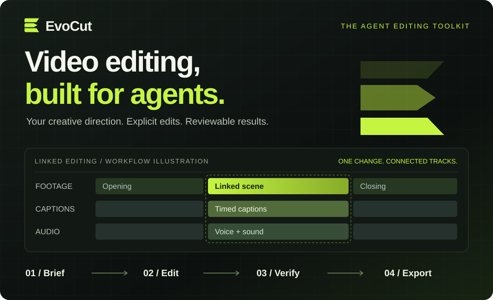

<div align="center">



### Creative direction from you. Editing tools for your agent.

Linked edits · Media & voice management · Reproducible releases · Evidence-bound QA

**[Get started](#get-started)** &nbsp; / &nbsp; **[Workflow](#from-brief-to-reviewable-output)** &nbsp; / &nbsp; **[Documentation](#go-deeper)** &nbsp; / &nbsp; **[中文](README.zh-CN.md)**

`v0.1.0 · Early-stage` &nbsp; `Node.js 22+` &nbsp; `macOS / Linux targets` &nbsp; `Apache-2.0¹`

</div>

---

## Give your agent an editing toolkit, not just a render command.

EvoCut brings editing, media organization, preview, rendering and quality checks into an agent-operable workflow. Keep footage, captions and sound connected. Make changes explicitly. Know which project source produced the file you review.

**For creators working with coding agents, developers building video workflows, and teams that need changes they can inspect and reproduce.** EvoCut provides the tools and skill guidance; you bring the agent, the creative brief and licensed media.

<table>
<tr>
<td width="50%" valign="top">

### 01 / Edit together

Cut or move supported linked clips with their captions, voice, sound effects and graphics. Conflict checks and undo help protect work already in progress.

[Linked editing →](tools/evocut/SEMANTIC-EDIT.md)

</td>
<td width="50%" valign="top">

### 02 / Keep media organized

Search assets in Chinese or English, deduplicate by hash, record source metadata, and retain confirmed voice profiles and pronunciation rules.

[Media & voices →](tools/evocut/MEDIA-LIBRARY.md)

</td>
</tr>
<tr>
<td width="50%" valign="top">

### 03 / Review the actual result

Bind successful renders to their source. Check decoding, black frames, audio and supplied transcription evidence. Separate technical results from human approval.

[Quality checks →](tools/video_qa/QUALITY_GATE.md)

</td>
<td width="50%" valign="top">

### 04 / Evolve without surprises

Stage an isolated release, validate its engine, tools and skills, then promote deliberately. Retain project pins and a rollback path.

[Managed releases →](tools/evocut/LOCAL-WORKFLOW.md)

</td>
</tr>
</table>

## From brief to reviewable output

| You direct | Your agent uses EvoCut to… | You can inspect |
| :--- | :--- | :--- |
| **Define the piece** | Apply relevant guidance from 29 video skill families | Editable source and explicit asset choices |
| **Refine the cut** | Preview, cut, move and undo supported linked elements | The composition, change results and remake plans |
| **Check the delivery** | Render an MP4 and run source-bound technical QA | The file, render receipt and QA report |
| **Keep what works** | Validate and pin a release before adopting changes | Versioned snapshots and integrity checks |

*The banner is a workflow illustration, not a Studio screenshot. Skill recipes may require additional licensed media and tools.*

## Get started

**Requirements:** Node.js 22+, npm, Python 3.10+, FFmpeg/ffprobe. Rendering also needs a supported Chromium browser and its platform dependencies. Windows has not been validated.

### 1. Set up an isolated checkout

```sh
git clone https://github.com/ruminate0810/evocut.git
cd evocut
python3 -m venv .venv
.venv/bin/python -m pip install -r requirements-dev.txt
export EVOCUT_PYTHON="$PWD/.venv/bin/python"
npm run setup -- --install-engine
```

Setup explicitly downloads the pinned engine, validates a release, and activates it inside this checkout. **It does not replace global commands, installed skills or existing videos.** Private-repository access is required while the repository remains private.

### 2. Preview and render the included example

```sh
npm run evocut -- check examples/hello --json
npm run evocut -- preview examples/hello
# Stop the preview server before continuing in the same terminal.
npm run evocut -- render examples/hello -o renders/hello.mp4
```

### 3. Check the exported file

```sh
npm run evocut -- qa --project examples/hello --video renders/hello.mp4 \
  --type silent --run --json-output renders/qa.json
```

The example is a **2-second silent smoke test**, not a showcase of generated footage. QA exit `3` means technical checks passed but required human review is still pending. Review the actual MP4 before approving a delivery.

<details>
<summary><strong>Installation notes & safeguards</strong></summary>

- Runtime files live in `.runtime`; managed releases live in `.evocut-home`. Set `EVOCUT_HOME` explicitly to use another location.
- Normal editing commands never download or upgrade the engine silently.
- The compiler may fetch default fonts. Cold-machine rendering is not guaranteed to work offline.
- Browser installation is a separate explicit setup action, not part of `npm test`.
- No npm package is published yet: do not use `npx evocut`. Optional `npm link` can expose a global command, but review any existing installation first.

</details>

## Useful tools. Honest boundaries.

EvoCut is an **editing toolkit**, not a video-generation model or an automatic publishing service.

- **Linked editing is conservative:** supported flat marked clips on the pinned engine; complex cases remain pending.
- **Shot remake creates a plan:** it does not automatically generate or replace footage.
- **Technical QA is not creative approval:** it cannot certify acting, identity, perfect lip sync or faithful style. Render receipts bind the composition index, not every external dependency.
- **Bring licensed assets and your own providers:** no stock-media pack, private voices, model credentials or paid synthesis is bundled. Asset search uses keywords, not acoustic understanding.

See the [full capability inventory and limits](docs/FEATURES.md). Finance analysis, social publishing and account login workflows are intentionally out of scope.

## Tested, with the evidence in view

| Initial local validation · 2026-10-13 | Result |
| :--- | :--- |
| Node regression tests | **102 passed** |
| Python regression tests | **115 passed** |
| Skill entrypoint metadata | **29 validated** |
| Included sample | **Rendered to MP4; technical QA passed** |

These are recorded macOS results, not a live CI badge or a promise that every template has been rendered. [Validation details →](docs/VALIDATION.md)

## Go deeper

| Create & edit | Maintain & contribute |
| :--- | :--- |
| [Agent skills entrypoint](tools/evocut/skills-src/evocut/SKILL.md) | [Release workflow](tools/evocut/LOCAL-WORKFLOW.md) |
| [Linked edits & undo](tools/evocut/SEMANTIC-EDIT.md) | [Feature inventory](docs/FEATURES.md) |
| [Media library & voices](tools/evocut/MEDIA-LIBRARY.md) | [Contributing](CONTRIBUTING.md) |
| [Video QA](tools/video_qa/QUALITY_GATE.md) | [Security](SECURITY.md) |

```sh
npm test
npm run audit:source
npm run evocut -- --help
```

**CI status:** a [GitHub Actions template](docs/ci/github-actions.yml) is provided but not enabled: the initial upload credentials lacked workflow-write permission. Linux CI has not yet been verified. See [development and engine updates](docs/DEVELOPMENT.md) for activation and release steps.

---

<div align="center">

**EvoCut — video editing, built for agents.**

[English](README.md) · [简体中文](README.zh-CN.md) · [Contribute](CONTRIBUTING.md) · [Security](SECURITY.md)

</div>

¹ Apache-2.0 with third-party exceptions: [LICENSE](LICENSE), [NOTICE](NOTICE), [third-party notices](THIRD_PARTY_NOTICES.md). Repository visibility is independent of licensing; `private: true` in package.json prevents accidental npm publication.
