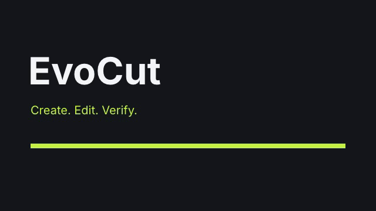

<div align="center">


# EvoCut

**让你的 AI Agent 直接剪辑视频。**

剪镜头、调字幕、预览效果、导出 MP4、检查成片。

[案例](#案例) · [开始使用](#开始使用) · [Agent 调用](#交给-agent-调用) · [English](README.md)

`v0.1.1 · 早期版本` · `macOS 已实测` · `命令行 + Agent 技能`

</div>

## 能做什么

- **剪辑：**剪切、移动受支持的关联画面、字幕和音频，带冲突检查与撤销。
- **管理素材：**检索本地素材，保留声音档案和发音规则。
- **交付：**预览项目、导出 MP4，检查实际导出的文件。

你提供能读写文件、执行命令的桌面 Agent；EvoCut 提供剪辑工具与技能。它不是视频生成模型，基础剪辑不要求安装 Codex。[完整能力与限制 →](docs/FEATURES.md)

## 案例

<a href="docs/EXAMPLES.md"></a>

| 可以试什么 | 能得到什么 |
| --- | --- |
| [导出一个片头](docs/EXAMPLES.md#1-片头导出--export-a-title-card) | 内置 2 秒项目 → MP4，上图为实际成片帧。 |
| [图文和字幕一起剪](docs/EXAMPLES.md#2-画面与字幕一起剪--cut-a-card-and-its-caption-together) | 6 秒图文示例 → 4 秒，已验证可撤销。 |
| [检查导出的文件](docs/EXAMPLES.md#3-导出后检查--check-the-actual-mp4) | 检查源文件绑定、解码等 → JSON 报告。 |

每个案例都有命令和可复制的 Agent 提示词。这些是可复现的技术示例，不冒充客户作品或生成效果展示。

## 开始使用

先安装 **Node.js 22+（含 npm）、Python 3.11+、FFmpeg/ffprobe**。以下步骤面向 macOS；Linux 尚未完成端到端验证，Windows 暂不支持自动安装。仓库保持私有期间，需要访问权限才能克隆。

```sh
git clone https://github.com/ruminate0810/evocut.git
cd evocut

# 先查看计划，再明确允许下载引擎和浏览器。
node scripts/cli.mjs env prepare --feature render
node scripts/cli.mjs env prepare --feature render --apply --allow-downloads
node scripts/cli.mjs env doctor --feature render --json
```

安装使用当前仓库和浏览器缓存，不替换全局命令、Agent 技能或已有视频。**目前没有发布 npm 包，请勿使用 `npx evocut`。** 可选 Python 依赖和换机步骤见[安装与迁移指南](docs/PORTABLE-SETUP.md)。

### 跑通第一个示例

```sh
node scripts/cli.mjs check examples/hello --json
node scripts/cli.mjs preview examples/hello
```

看完预览后按 `Ctrl+C` 停止服务，再在同一终端导出：

```sh
node scripts/cli.mjs render examples/hello -o renders/hello.mp4
```

视频在 **`renders/hello.mp4`**。这是 2 秒无声测试片，不是生成效果展示。首次运行可能获取在线字体，并非完整离线安装。

## 交给 Agent 调用

运行下面的命令，获取这台电脑的**绝对启动路径、环境配置和技能入口**：

```sh
node scripts/cli.mjs agent instructions
```

把输出交给 Agent，再附上这段话：

```text
请使用上面的 EvoCut launcher，并保留它的环境配置。
先读取 skillEntry 及相关引用，再检查我的视频项目。
说明剪辑计划，按我的要求修改；检查通过后先给我预览，确认后再导出。
未经确认，不升级已有项目，不调用付费生成服务。
```

要安装到技能目录，或从其他项目目录调用，见 [Agent 快速接入 →](docs/AGENT-QUICKSTART.md)。只有聊天或 MCP 客户端、不能执行本地命令的应用，还需要额外适配；当前项目不提供 MCP Server。

## 常用命令

从 EvoCut 仓库目录执行，把 `<project>` 替换为视频项目路径。

| 需要做什么 | 命令 |
| --- | --- |
| 检查运行环境 | `node scripts/cli.mjs env doctor --feature render --json` |
| 查看时间线 | `node scripts/cli.mjs timeline <project> --json` |
| 检查项目 | `node scripts/cli.mjs check <project> --json` |
| 打开编辑器 | `node scripts/cli.mjs preview <project>` |
| 确认后导出 | `node scripts/cli.mjs render <project> -o renders/final.mp4` |

## 文档

[安装与迁移](docs/PORTABLE-SETUP.md) · [Agent 接入](docs/AGENT-QUICKSTART.md) · [联动剪辑与撤销](tools/evocut/SEMANTIC-EDIT.md) · [素材与声音](tools/evocut/MEDIA-LIBRARY.md) · [成片检查](tools/video_qa/QUALITY_GATE.md) · [参与开发](CONTRIBUTING.md)

**验证状态：**2026-10-13 的 macOS 验证记录为 120 项 Node、115 项 Python 测试通过，不表示所有技能或平台均已验证；CI 尚未启用。[查看验证记录](docs/VALIDATION.md)。

**使用边界：**不附带商业素材、私人声音或生成服务；镜头重做只产生计划，不自动生成画面；技术检查不能代替创作审核。[完整限制](docs/FEATURES.md)。

---

[Apache-2.0](LICENSE)，第三方例外见[组件声明](THIRD_PARTY_NOTICES.md)与 [NOTICE](NOTICE)。[安全说明](SECURITY.md)。许可证不改变仓库可见性。
